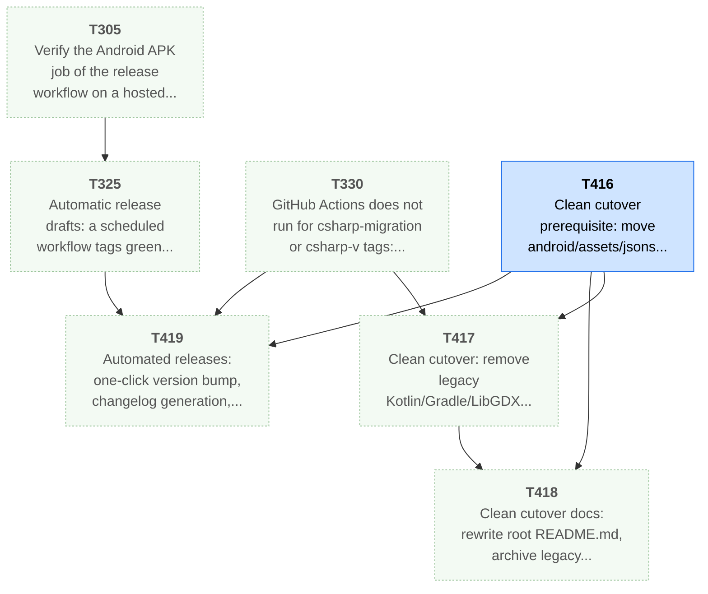
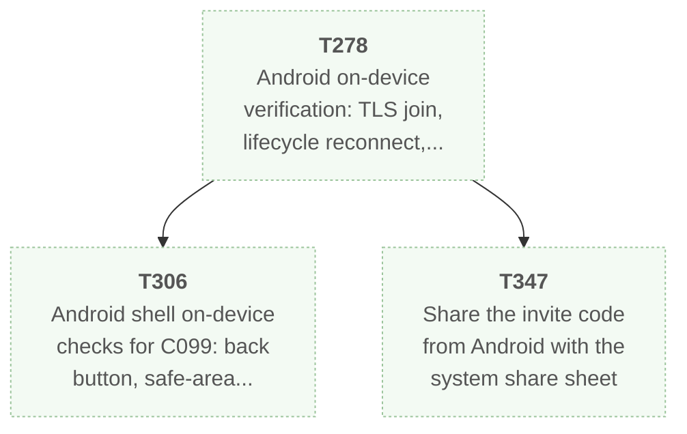
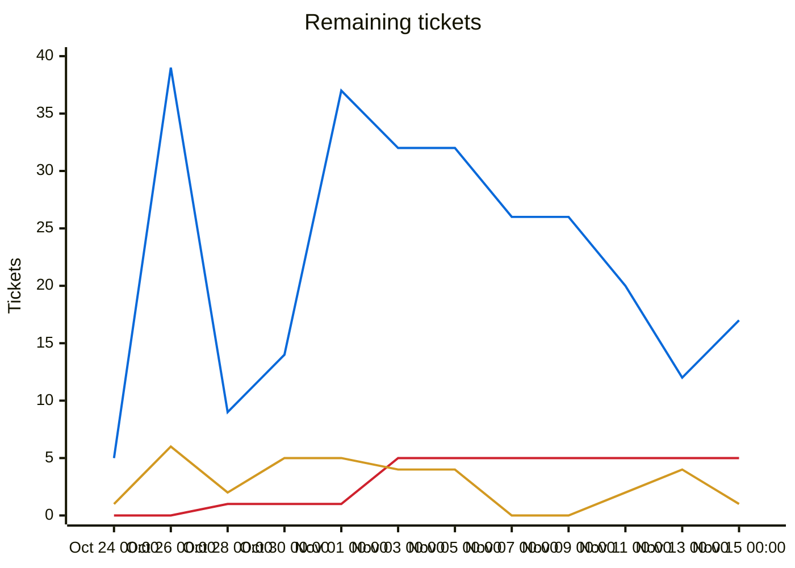
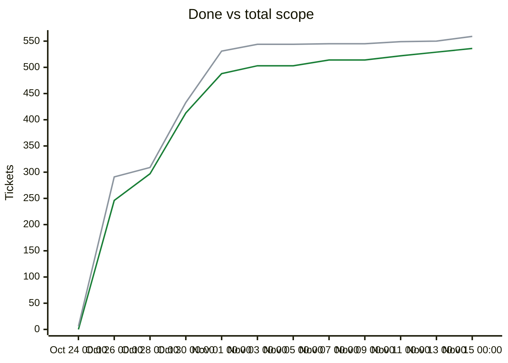

# Migration dependency map

<!-- toc -->
## Contents

- [Delivery phases](#delivery-phases)
- [Ready and on deck](#ready-and-on-deck)
- [Dependency diagrams](#dependency-diagrams)
  - [Group of T305: 7 tickets (phase 1, 5)](#group-of-t305-7-tickets-phase-1-5)
  - [Group of T278: 3 tickets (phase 5)](#group-of-t278-3-tickets-phase-5)
- [Remaining tickets over time](#remaining-tickets-over-time)
- [Progress and scope over time](#progress-and-scope-over-time)
- [Incomplete tickets](#incomplete-tickets)
<!-- /toc -->

## Delivery phases

Work is completed phase by phase (`phases.txt`; `ticket.py ready`/`next` list earlier phases first; later phases fill idle capacity).

| Phase | Done | Remaining | Ready | In flight | Remaining tickets |
|---|---|---|---|---|---|
| Phase 1: CLI (headless engine) | 231/241 | 10 | 5 | 1 | [T404](backlog/T404.md) [T411](backlog/T411.md) [T412](backlog/T412.md) [T413](backlog/T413.md) [T414](backlog/T414.md) [T415](backlog/T415.md) [T416](backlog/T416.md) [T417](backlog/T417.md) [T418](backlog/T418.md) [T419](backlog/T419.md) |
| Phase 2: single player (Godot client) | 57/57 | 0 | 0 | 0 | complete |
| Phase 3: multiplayer | 76/79 | 3 | 0 | 0 | [T355](backlog/T355.md) [T357](backlog/T357.md) [T394](backlog/T394.md) |
| Phase 4: queued plans (UI redesign, unit models, BNW) | 82/82 | 0 | 0 | 0 | complete |
| Phase 5: owner issue backlog (Android, performance, ultra graphics, dedicated server, resiliency) | 83/93 | 10 | 0 | 0 | [T278](backlog/T278.md) [T290](backlog/T290.md) [T305](backlog/T305.md) [T306](backlog/T306.md) [T313](backlog/T313.md) [T325](backlog/T325.md) [T330](backlog/T330.md) [T332](backlog/T332.md) [T347](backlog/T347.md) [T362](backlog/T362.md) |

Generated by `tools/ticket.py` on every backlog change; do not edit by hand. Lists every incomplete ticket; completed tickets are hidden. The diagrams show only tickets that are linked by an open dependency, one small diagram per linked group; an arrow `A --> B` means B depends on A. The tables list everything, including unlinked tickets.

| Colour | Meaning |
|---|---|
| bright green, thick border | Ready to start: Available and every dependency is Done |
| orange, thick border | On deck: Available, and every unfinished dependency is already in progress or in review, so it becomes ready when those finish |
| pale green, dotted border | Available but waiting on dependencies that are not started yet |
| yellow | In-Progress |
| blue | Needs-Review / In-Review |
| red | Blocked |

## Ready and on deck

| Ticket | Status | Unblocks | Title |
|---|---|---|---|
| T411 | **Ready to start** | 0 | UX polish: fix inline glyph substitution, semantic icon assignments, checkbox states, and raw text formatting |
| T412 | **Ready to start** | 0 | UX polish: resolve HUD banner/modal overlap, add Next-Turn scrim, restore alert icons, and fix compact/phone layout collisions |
| T413 | **Ready to start** | 0 | UX polish: add 'show, don't tell' progress bars, segmented gauges, threshold markers, slot pips, and connection timers |
| T414 | **Ready to start** | 0 | UX polish: consolidate Setup/Host/Lobby/Options/Saves flows, strip duplicate chrome, and replace blank voids with EmptyState and icons |
| T415 | **Ready to start** | 0 | UX polish: unify Espionage flows, prune vestigial Diplomacy/Trade/Pedia/Tutorial chrome, add Decision icons, and fix compact DataTables |

## Dependency diagrams

### Group of T305: 7 tickets (phase 1, 5)

### Group of T278: 3 tickets (phase 5)

Unlinked tickets (no open dependency in either direction), by state:

- ready: T411 T412 T413 T414 T415
- blocked: T290 T355 T357 T394 T404
- waiting: T313 T332 T362

## Remaining tickets over time

Generated from the git history of `backlog/` (times are UTC; each point is the backlog as of that time, the last one the current backlog). Completed tickets (Done, Won't port) are not counted in this chart.

| Line | Meaning |
|---|---|
| blue (#0969da) | New: Available, not started yet |
| red (#cf222e) | Blocked |
| amber (#d29922) | Active: In-Progress, Needs-Review or In-Review |

## Progress and scope over time

| Line | Meaning |
|---|---|
| green (#1a7f37) | Done: Done or Won't port, cumulative |
| grey (#8c959f) | Total scope: every ticket that existed at that time; a rise here is new tickets, not lost progress |

## Incomplete tickets

| Ticket | State | Depends on | Unblocks | Title |
|---|---|---|---|---|
| T411 | **Ready to start** | none | 0 | UX polish: fix inline glyph substitution, semantic icon assignments, checkbox states, and raw text formatting |
| T412 | **Ready to start** | none | 0 | UX polish: resolve HUD banner/modal overlap, add Next-Turn scrim, restore alert icons, and fix compact/phone layout collisions |
| T413 | **Ready to start** | none | 0 | UX polish: add 'show, don't tell' progress bars, segmented gauges, threshold markers, slot pips, and connection timers |
| T414 | **Ready to start** | none | 0 | UX polish: consolidate Setup/Host/Lobby/Options/Saves flows, strip duplicate chrome, and replace blank voids with EmptyState and icons |
| T415 | **Ready to start** | none | 0 | UX polish: unify Espionage flows, prune vestigial Diplomacy/Trade/Pedia/Tutorial chrome, add Decision icons, and fix compact DataTables |
| T330 | Available (waiting on ) | none | 3 | GitHub Actions does not run for csharp-migration or csharp-v tags: diagnose (account, billing, rename to Kenmura/UncivSharp, settings), restore CI, then re-run the tag workflow |
| T416 | Needs-Review [Antigravity] | none | 3 | Clean cutover prerequisite: move android/assets/jsons into csharp/data/jsons and decouple all runtime, test, and packaging paths |
| T278 | Available (waiting on ) | T260, T276 | 2 | Android on-device verification: TLS join, lifecycle reconnect, frame time and APK size on a mid-range phone |
| T305 | Available (waiting on ) | T280 | 2 | Verify the Android APK job of the release workflow on a hosted runner (first tag push) |
| T325 | Available (waiting on T305) | T279, T280, T305 | 1 | Automatic release drafts: a scheduled workflow tags green csharp-migration when it has new Done work and creates a DRAFT GitHub release with generated notes; the owner publishes by hand |
| T417 | Available (waiting on T416, T330) | T416, T330 | 1 | Clean cutover: remove legacy Kotlin/Gradle/LibGDX code, unused assets, and legacy CI workflows |
| T290 | Blocked | T271 | 0 | Real-device frame-time pass: Windows, macOS, Android phone |
| T306 | Available (waiting on T278) | C099, T278 | 0 | Android shell on-device checks for C099: back button, safe-area insets, orientation, lifecycle autosave, keyboard scroll, permissions |
| T313 | Available (waiting on ) | T311 | 0 | Verify OS display scale detection on Windows, macOS and X11 and follow a window moved between monitors (T311 follow-up) |
| T332 | Available (waiting on ) | none | 0 | Verify Windows and macOS CLI and the Windows dedicated server on real systems, then drop the UNVERIFIED marks from the release notes |
| T347 | Available (waiting on T278) | T278 | 0 | Share the invite code from Android with the system share sheet |
| T355 | Blocked | T338 | 0 | Verify nested TLS and the relay path on Windows, macOS and Android (manual, UNVERIFIED until run) |
| T357 | Blocked | T337, T338 | 0 | WebSocket gateway so the web export can join and host through the relay (optional) |
| T362 | Available (waiting on ) | T334 | 0 | Two real client processes host and join on the real GPU (manual two-profile smoke) |
| T394 | Blocked | T356 | 0 | Owner-run independent verification of the civsharp relay (CONNECTIVITY.md rows R2-R4, R7-R9, R13) and record results |
| T404 | Blocked | T301 | 0 | T301 follow-up: window maximize/resize on Wayland-native, Windows, macOS and with UiScale != 1 in the real app |
| T418 | Available (waiting on T416, T417) | T416, T417 | 0 | Clean cutover docs: rewrite root README.md, archive legacy changelog, and update contributor/modding docs for C#/.NET + Godot |
| T419 | Available (waiting on T325, T330, T416) | T325, T330, T280, T416 | 0 | Automated releases: one-click version bump, changelog generation, optional Android release signing, and main-branch workflow alignment |
